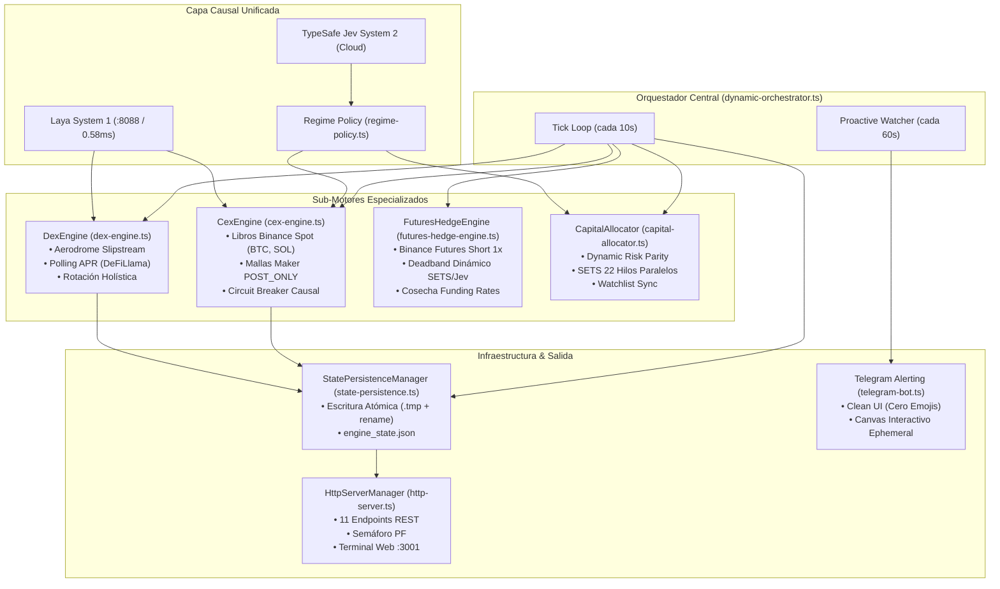

# Arquitectura Modular V3 — Alpha Engine

> **Documento histórico (etapa previa a la refutación).** Puede contener proyecciones y cifras que el proyecto refutó. Ver [`HISTORY.md`](HISTORY.md) y [`CONCLUSIONS.md`](CONCLUSIONS.md).

Documento de especificación técnica de la arquitectura desacoplada de Alpha Engine (Modular V3).
Diseñado para cómputo asíncrono de baja latencia en el nodo `compute-node` (HP EliteBook G11, 22 hilos, 30 GB RAM) ejecutando sobre Bun runtime.

---

## 1. Visión General del Sistema

Alpha Engine Modular V3 descompone el monolito operacional original en **submotores altamente especializados** coordinados por un núcleo delgado (`DynamicAlphaOrchestrator`) que preserva la separación estricta entre la simulación de capital institucional (Modo Paper) y la auditoría de tesorería real (Modo Live en Binance Spot y Base L2).



---

## 2. Los 6 Módulos Centrales

### 2.1 Coordinador Central (`dynamic-orchestrator.ts`)
- **Responsabilidad:**
  - Instancia y coordina los 5 submotores.
  - Ejecuta el ciclo `tick()` cada 10 segundos.
  - **Centinela Proactivo en Segundo Plano:** `setInterval(60_000)` vigila 3 condiciones de fallo sin detener el motor:
    1. `pfSignal` en rojo (`profitFactor < 0.75`).
    2. Posición CEX en `PAUSED` con inventario abierto por más de 30 minutos.
    3. Posición DEX en `PAUSED_DEFENSIVE` (fuera de rango) por más de 10 minutos.
  - Computa en cada pulso el **PnL Latente Mark-to-Market** y el **Valor Efectivo del Portafolio** (`Capital Base + PnL Latente CEX + Fees Acumuladas DEX`).

### 2.2 Motor Táctico CEX (`cex-engine.ts`)
- **Responsabilidad:**
  - Orquestación de mallas elásticas por ATR en libros nativos de Binance Spot (`BTCUSDT`, `SOLUSDT`).
  - Ejecución estricta Maker Post-Only (`LIMIT_MAKER`) con comisiones del 0.10%.
  - **Pipeline de Microestructura por Activo:**
    1. Inferencia Laya local (`< 1 ms`) vía HTTP contra `:8088`.
    2. Cálculo de Order Flow Imbalance (OFI) y evaporación de profundidad top-3.
    3. Escalado reactivo a TypeSafe Jev System 2 ante anomalías o caducidad del vector de estado (120s).
    4. **Circuit Breaker Causal Unificado:**
       - Umbral de toxicidad ponderado por régimen: `0.82` en `AGGRESSIVE`, `0.70` en `BALANCED`, `0.60` en `DEFENSIVE`.
       - **Reconciliación OFI:** Si `ofiScore > +0.55` (presión compradora neta institucional), el flujo se reclasifica como no tóxico.
       - Si el circuit breaker se activa pero hay posición abierta, el bot **bloquea nuevas compras pero mantiene activa la gobernanza de salidas**.
    5. Hard Stop previo incondicional antes de DCA Out.

### 2.3 Motor de Liquidez DEX (`dex-engine.ts`)
- **Responsabilidad:**
  - Simulación y control de posiciones de liquidez concentrada en Aerodrome Slipstream (Base L2).
  - **Polling Dinámico de APR:** Consulta cada 10 minutos pools concentrados con liquidez profunda institucional en DeFiLlama / DexScreener.
  - **Rotación Holística de Cartera DEX:**
    - Si un pool acumula más de 3 pausas defensivas consecutivas (fuera de rango), gatilla una rotación atómica de todo el bloque DEX.
    - Preserva las comisiones acumuladas históricas mediante transferencias de snapshot mutable (`prevAccFees`).
  - Cálculo de gas dinámico simulando `eth_estimateGas` contra Base Mainnet RPC.

### 2.4 Motor de Cobertura Delta-Neutral en Futuros (`futures-hedge-engine.ts`)
- **Responsabilidad:**
  - Sincronización en tiempo real como esclavo de las posiciones activas en DEX (Base L2).
  - **Apalancamiento Estricto 1x:** Cobertura corta proporcional en Binance Futures (`AEROUSDT`, `ETHUSDT`, `BTCUSDT`) eliminando la pérdida impermanente (IL).
  - **Centinela de Deadband Dinámico (SETS + Jev):** Modula la tolerancia de rebalanceo (2.5% a 9.5%) según la temperatura ATR y el régimen macro, evitando el sobre-ajuste y el churn de comisiones.
  - **Cosecha Continua de Funding Rates:** Captura entre un +7% y +16% de APR en tasas de financiamiento pasivas cada 8h.
  - **Gobernanza de Márgenes:** Inyección automática de colateral desde la reserva fiduciaria de USDT si el margen cae del 40%, manteniendo los precios de liquidación a más del +90% de distancia.
  - **Destrucción de Coberturas Huérfanas:** Cierra el Short inmediatamente si el pool correspondiente en DEX es liquidado o rotado.

### 2.5 Asignador de Capital & SETS (`capital-allocator.ts`)
- **Responsabilidad:**
  - Aplica la política macro (`RegimePolicy`) para dividir el capital entre Reserva USDT, CEX Spot y DEX LP.
  - **Paridad de Riesgo Causal:** Ejecuta `calculateDynamicRiskWeights()` optimizando pesos porcentuales por Sortino y volatilidad histórica.
  - **Optimización Genética Paralela en Compute-node (SETS):**
    - Despliega 22 hilos nativos para mutar y evaluar genomas mediante series Walk-Forward.
    - Gate estricto: rechaza genomas con `maxDD >= 0.06` o `winRate < 0.50` (en `DEFENSIVE_STRESS` exige `payoff >= 1.20` y penaliza `maxDD * 1.5`).

### 2.6 Servidor HTTP & API Telemetría (`http-server.ts`)
- **Puerto:** `3001` (expuesto a través de túnel seguro Pangolin en `https://alpha.joces.org/`).
- **Endpoints Expuestos (11):**
  - `GET /` & `/index.html`: Dashboard institucional dual Obsidian Dark con selector de pestañas (Simulador vs Real), observabilidad táctica de mallas, rangos DEX y tarjetas de cobertura de futuros.
  - `GET /status`: Payload maestro unificado con telemetría causal, microestructura L1/L2, semáforo PF, tasas spot en vivo y estado completo de `futuresHedge` (notional, funding cobrado, deadband dinámico).
  - `GET /wallets`: Auditoría en vivo de balances en Binance Spot y Hot Wallet on-chain en Base L2.
  - `GET /metrics/winrate`: Estadísticas agregadas del log de telemetría RLCD (precisión anti-caídas, safe entries).
  - `GET /metrics/comparison`: Cuadro comparativo estricto Paper (Simulador) vs Real (Producción).
  - `POST /control/pause`: Congelamiento preventivo de cotizaciones y cancelación de órdenes.
  - `POST /control/resume`: Reactivación de quoting.
  - `POST /control/flatten`: Liquidación de emergencia.

### 2.7 Persistencia Atómica (`state-persistence.ts`)
- **Archivo:** `data/engine_state.json`.
- **Garantía ACID en Disco:** Escribe primero en archivo temporal único (`data/engine_state.json.tmp.<PID>.<TIMESTAMP>`) con `fsync` forzado y realiza un `rename` atómico POSIX.
- Previene corrupción de estado ante cortes de energía o reinicios intempestivos del daemon.

---

## 3. Política Causal de Régimen (`regime-policy.ts`)

Actúa como **fuente de verdad institucional** que conecta la ponderación macro de capital con los criterios de salida de mercado:

| Régimen Jev | Reserva Líquida (USDT) | Capital CEX Spot | Capital DEX LP | TP1 Parcial | TP2 Parcial | Front-Run Min |
|---|---|---|---|---|---|---|
| **`AGGRESSIVE_ACCUMULATION`** | 30.0% del total | 65.0% del activo | 35.0% del activo | **+2.80%** | +4.20% | +0.85% |
| **`BALANCED_RANGE`** | 40.0% del total | 50.0% del activo | 50.0% del activo | **+2.40%** | +3.80% | +0.75% |
| **`DEFENSIVE_STRESS`** | 50.0% del total | 40.0% del activo | 60.0% del activo | **+1.80%** | +3.00% | +0.60% |

---

## 4. Gobernanza Causal de Salidas (`exit-governance.ts`)

La liquidación de inventario se gestiona bajo el paradigma **Triple-Barrier Meta-Labeling**:

1. **EMERGENCY_DELEVERAGE (Phase 4):**
   - Requiere estrictamente: Pérdida $\le -3.00\%$ **Y** (`toxicFlow >= 0.90` **O** `ofiScore <= -0.85`).
   - Previene liquidaciones prematuras ante ruido normal de mercado (-1.0% a -2.0%).
2. **FRONT_RUN_EXIT:**
   - Si la posición tiene ganancia $\ge \text{frontRunMin}$ y el libro se descompone bruscamente (`OFI < -0.50` o `toxicFlow > 0.50`), liquida el 100% al mejor bid disponible para asegurar ganancia líquida.
3. **TAKE_PROFIT_PARTIAL 1 (Free-Roll Lock):**
   - Asegura el 40% del inventario al tocar `tp1Threshold` y eleva el hard stop a precio medio.
4. **TRAILING_EXPANSION:**
   - Si se toca TP1 pero `ofiScore > +0.60` con bajo `toxicFlow` en régimen `AGGRESSIVE`, posterga la venta parcial y proyecta el objetivo un +2.5% adicional para dejar correr la tendencia.

---

## 5. Control de Despliegue en Producción

```bash
# Suite de pruebas automatizadas (48 tests unitarios e integrados)
bun test

# Despliegue sincronizado hacia Compute-node
rsync -avz --exclude 'node_modules' --exclude '.git' --exclude 'data' /root/proyectos/alpha-engine/ compute-node:/home/user/proyectos/alpha-engine/

# Reinicio controlado del servicio systemd de usuario
compute-node-exec "systemctl --user restart alpha-engine.service"

# Verificación de telemetría en caliente
ssh compute-node "curl -s http://127.0.0.1:3001/status | jq '{regime: .macroAllocation.predominantRegime, effectivePortfolioUsd: .effectivePortfolioUsd, paperMetrics: .paperMetrics}'"
```
